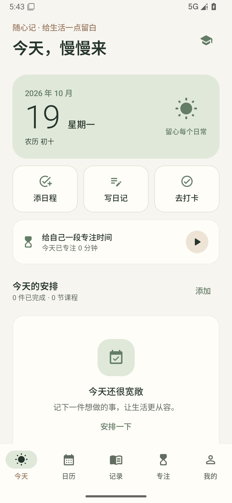
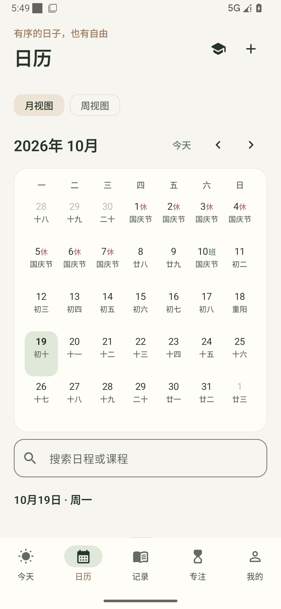
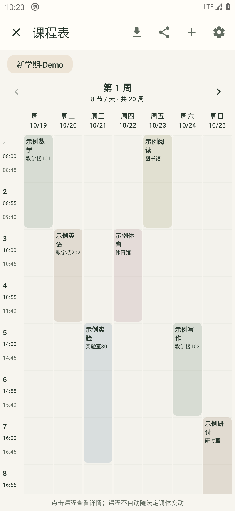

# 随心记

面向个人学习、工作与生活的原生 Android 应用。支持 Android 10（API 29）及以上手机，包含日历、日程、图文日记、习惯打卡、番茄钟与学期课程表。

## 安装与使用

从 [版本发布页](https://github.com/ShingStars/suixinji-android/releases/latest) 下载 `Suixinji-1.1.0.apk`。如果系统询问，请允许当前文件管理器安装应用。应用无账号，初次打开没有演示记录。

## 界面预览

<p>
  
  
  
</p>

- **今天**：查看当日安排与待打卡事项，快速新增日程、写日记和开始专注。
- **日历**：切换月/周视图，点击日期查看当天日程、课程、日记和打卡；右上角进入课程表。绿色点为日程，蓝色为课程，粉色为日记，棕色为打卡。
- **记录**：在日记与习惯间切换。日记输入后自动保存，也可点“完成”保存退出。图片导入后保存至应用私有目录。习惯详情支持数值累计、历史补卡、统计及误记删除。
- **专注**：可选择自由专注或关联日程，设置专注/休息时长，开始、暂停、继续或提前结束。每轮结束后手动开始下一轮。
- **我的**：切换主题、管理学期和节次、设置提醒与应用锁、导出备份和查看回收站。

## 课程表

1. 在“我的 → 学期管理”创建学期，设置开学日期、总周数及每日节次。时间每行一节，如 `08:00-08:45`。
2. 在日历右上角打开课程表，添加课程，选择星期、节次、全周/单双周/指定周、教室和教师。
3. 点击课程可调整单次安排、编辑整个系列、复制课程或取消本次。系列的临时调整可在详情中恢复。

开学日期所在周为第 1 周，每周从周一开始；开学日期之前不排课。学校安排不自动跟随法定放假或调休，请手动调整临时课程。


## v1.1.0 更新

- 五个主页面支持左右滑动，左滑进入右邻页、右滑返回左邻页，首页和末页不循环。
- “我的”顶部可编辑头像、昵称（最多 10 个字）与签名（最多 30 个字），保留日记/习惯数量。头像可裁剪、缩放、调整位置或恢复默认，个人资料随加密备份保存；兼容 v1.0.0 备份。
- 课程表为独立全屏七列网格，周一到周日同时可见，全部节次上下滚动，点击课程查看详情。
- 课程表顶部支持导入与分享：分享当前选中教学周的完整 PNG 长图，可选显示教师，默认不含个人资料。保存至相册无需广泛存储权限。
- “我的 → 检查更新”查询本仓库正式 Release；自动检查可关闭，每天最多一次。可稍后处理或忽略版本，确认后才下载；校验 SHA-256、包名、递增版本与相同签名后交给系统确认安装，不自动安装。GitHub 不可达时仍可使用所有本地功能。

### 课程导入

先创建目标学期，确认开学日期、教学周和节次钟点。导入保留这些配置，学校课表 HTML 通常不包含钟点。

1. 课表右上角点“导入课程”。CSV 可从界面保存模板，用 Excel/WPS 填写并“另存为 CSV”，不支持直接读取 `.xlsx`、PDF、图片或 WakeUp 分享口令。
2. CSV 表头依次为：`课程名称,星期,开始节数,结束节数,老师,地点,周数`。星期为 1–7（周一到周日）；周数支持 `1-16`、`1-16(单)`、`1-4,8-12`，含逗号的字段按 CSV 标准用双引号包围。支持 UTF-8、GB18030，单文件不超过 2 MB。
3. 苏大正方 HTML 选择实际“学生课表”页面。如果浏览器保存了门户外壳及同名资源文件夹，请选择资源文件夹里的 `content_xs.html`。只解析课程信息，不保存网页原文、学号、姓名或登录状态。
4. 预览全部识别结果。完全重复的课程合并，默认追加并跳过现有重复项。选择“替换该学期全部课程”需二次确认，原课程及单次调整进入 30 天回收站。格式错误修正后才可导入；冲突提示允许继续。
5. “苏州大学教务导入”尝试可信 HTTPS 页面，由本人手动登录和输入验证码，打开“信息查询 → 学生课表”后读取。证书异常不绕过；只能 HTTP 时使用外部浏览器，由用户决定是否登录后保存 HTML 再导入。HTTP 本身不加密登录信息。

苏大解析已用用户提供的本地课表结构验证，包括重复表格、同格多安排和不同教学周；公开测试使用重建的匿名样本。在线登录、校园网络/VPN及未来教务页面变更仍需在学校环境安装验收，不承诺其他学校通用。

## 日期、打卡与计时规则

- 每月指定日期不存在时跳过该月，不自动改到月底。
- 日程完成、打卡和专注记录各自独立；关联专注不会自动完成日程。
- 每周打卡目标按不同完成日期计次，数值型习惯可在一天内多次累计。指定星期的休息日不打断连续记录。补卡会标记为补录并重算统计。
- 日期和日程钟点跟随系统本地时区；历史日记、打卡及专注统计保留记录所属日期。
- 番茄钟使用实际经过时间，锁屏后继续。暂停不计时；提前结束保留实际时长但不计完整轮次。重启手机后未结束会话标为中断，只计入已确认的片段。

## 提醒

日程和课程默认提前 10 分钟，全天事项默认当天 09:00；习惯提醒需逐项开启。在“我的 → 提醒设置”检查系统通知和准时提醒权限，也可单独关闭各模块通知。

拒绝权限仍可记录和计时；应用会提示提醒不可用或可能延迟。系统勿扰、通知渠道设置及厂商省电策略也会影响提醒。强制停止应用后需重新打开以恢复调度。

## 应用锁

在“我的”开启，使用系统生物识别或设备凭据。每次冷启动/进程重建验证一次；后台返回或锁屏返回不重复验证。可点“立即锁定”。允许截图录屏；Android 13+ 隐藏最近任务预览，Android 10–12 的预览可能显示内容。开启后通知不展示具体事项内容。

## 备份与换机

1. 打开“我的 → 备份与恢复”，输入至少 8 位密码并再次确认。
2. 点“导出完整加密备份”，选一个自己能够找回的位置。文件扩展名为 `.sxj`，包括记录、日记图片、普通设置和未过期的回收站。
3. 在新手机安装应用，填入原备份密码，选择“从备份完整恢复”。恢复完整替换本机数据，不做合并。

**密码无法找回。** 恢复前会验证格式、认证标签、清单和附件；错误密码或损坏文件不覆盖当前记录。替换前保存当前数据的加密安全副本，可点“导出最近一次恢复前副本”导出；该副本使用本次恢复所填的密码。设备凭据、应用锁状态和正在运行的计时不迁移。

记录默认在本机私有目录，系统自动云备份和换机迁移已排除。**卸载/清除应用数据前请导出备份。** 删除的内容在回收站保留 30 天；永久清除后只能从此前导出的备份找回。

## 联网与开源数据

个人记录不上传，无广告或行为分析。新增联网范围包括 GitHub 正式版查询和用户确认后的安装包下载，以及本人操作的校方教务网页；教务登录信息直接交给校方。版本请求不附带个人资料或应用生成的用户标识。节假日功能请求 `raw.githubusercontent.com/NateScarlet/holiday-cn/master/{year}.json` 更新公开节假日安排，最多每七天检查一次，另提供手动更新。安装包内置 2025、2026 年数据。来源不可达时保留本地数据；空的未来年度不覆盖有效缓存，也不推算调休。

节假日来源为 [NateScarlet/holiday-cn](https://github.com/NateScarlet/holiday-cn)，采用 MIT 许可，具体国务院公告链接在应用中展示。网络可达性依使用网络而异。完整许可见 `app/src/main/assets/holidays/LICENSE.txt`。

## 开发与构建

固定基线：JDK 17 / Gradle 8.13 / AGP 8.13.2 / Kotlin 2.3.10 / Compose BOM 2025.12.00 / Room 2.8.4 / KSP2 2.3.6 / Biometric 1.1.0；`minSdk=29`、`compileSdk=targetSdk=36`。

Windows 项目自带脚本，工具只安装到项目 `.tools` 目录：

```powershell
pwsh -NoProfile -File tools/bootstrap.ps1
pwsh -NoProfile -File tools/signing.ps1
& ./tools/build.ps1 -Tasks @(':app:assembleRelease', ':app:testDebugUnitTest', ':app:lintDebug')
```

也可在 Android Studio 中打开项目，使用本机 SDK 与 JDK 17 构建。安装 Android SDK Platform 36 和 Build Tools 35.0.0，配置 `ANDROID_HOME` 或在 `local.properties` 中设置 `sdk.dir`，然后运行：

```sh
./gradlew :app:assembleDebug :app:testDebugUnitTest :app:lintDebug
```

Windows 对应使用 `gradlew.bat`。调试安装包位于 `app/build/outputs/apk/debug/`。`local.properties` 指向本机 SDK，不随源码交付。若官方 Gradle 分发站连接失败，Windows 准备脚本使用镜像并核对官方 SHA-256。

`signing.properties` 和 `.tools/signing/suixinji.jks` 是本项目个人发布密钥配置，不包含在源码压缩包中。请私下保管，后续覆盖升级必须使用同一签名；首次自行构建可运行签名脚本生成自己的密钥。

## 结构与测试

- `app/src/main/java/cn/suixinji/app/data`：版本化数据模型、Room 存储与仓库。
- `domain`：重复规则、教学周、打卡统计、计时计算。
- `platform`：系统提醒、节假日更新及认证加密备份。
- `ui`：Compose 页面、表单、主题与交互。
- `app/src/test`：日期与统计规则、备份加密单元测试。
- `app/src/androidTest`：真实界面、数据库、回收站与备份恢复测试。
- `qa/TEST_REPORT.md`：实际验收结果与待真机确认项目。

数据使用稳定 ID。重复规则、单次例外与完成快照分别保存；Room 记录按类型序列化，数据库版本和备份格式版本独立管理。恢复使用持久化回滚日志，进程异常中断后在应用解锁前恢复原数据。

## 开源许可

本项目源码采用 [MIT 许可证](LICENSE)。第三方依赖及节假日数据保留各自许可，详见 [第三方声明](THIRD_PARTY_NOTICES.md)。发布签名密钥、密码、本机配置与个人记录不包含在仓库中；自行签名的安装包无法直接覆盖官方签名版本，请先导出备份。
